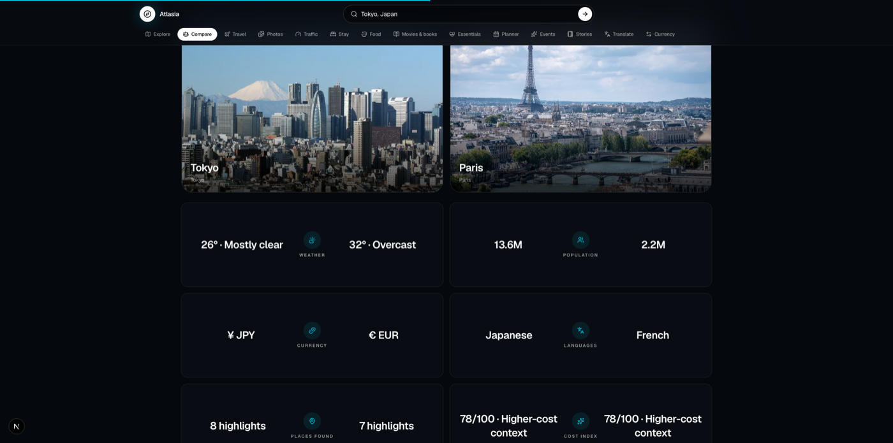
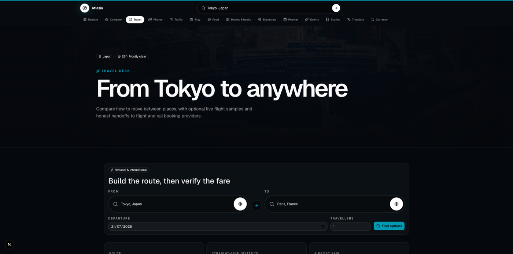
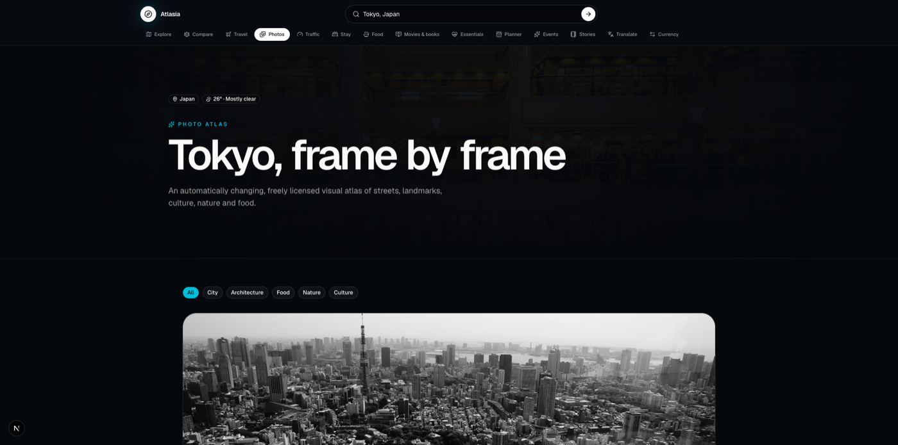
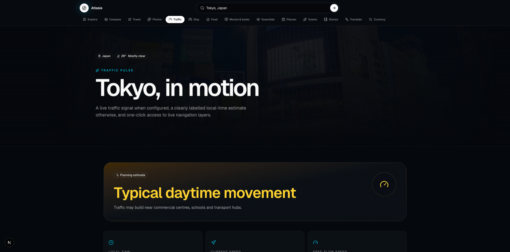

# Atlasia

Atlasia is a dynamic, weather-reactive place intelligence and trip-planning dashboard. Search a place and get its story, attractions, food, people, transport, traffic, map, photos, weather, currency, stays, news, videos, events, comparisons, route handoffs, and an in-context Groq travel companion.

## Live deployment

**[Explore Atlasia on Vercel →](https://atlasia-explorer.vercel.app)**

The production deployment includes the server-side Groq, GNews, and YouTube integrations while keeping every API key private.

## Screenshots

Click any screenshot to open that experience on the deployed website.

| City comparison | National and international travel |
| --- | --- |
| [](https://atlasia-explorer.vercel.app/compare?place=Tokyo%2C%20Japan) | [](https://atlasia-explorer.vercel.app/travel?from=Tokyo%2C%20Japan&to=Paris%2C%20France) |
| **Dynamic photo atlas** | **Traffic tracker** |
| [](https://atlasia-explorer.vercel.app/photos?place=Tokyo%2C%20Japan) | [](https://atlasia-explorer.vercel.app/traffic?place=Tokyo%2C%20Japan) |

## What is already built

- Local autocomplete backed by a generated 34,000-city GeoNames dataset—no third-party request per keystroke.
- One aggregator endpoint: `GET /api/place?name=Tokyo, Japan`.
- Parallel, isolated source adapters. A news or hotel failure never blocks weather, maps, or Wikipedia.
- Seven-day cache through Supabase, with a process-memory fallback for zero-config local use.
- Wikipedia place imagery plus weather-driven colour, glow, rain, snow, cloud, day, and night effects.
- Leaflet + OpenStreetMap map with attractions, transport, airports, and hotels.
- Streaming Groq chatbot using AI SDK v6 and AI Elements markdown rendering.
- Responsive loading, error, empty, and unconfigured-source states.
- Dedicated comparison, travel, photo-atlas, live/planning traffic, stays, food, culture, essentials, currency, translation, planner, events, and stories routes.
- Rich city comparison across photos, weather, population, currency, language, attractions, cost, dishes, notable people, and nearby flora/fauna observations.
- Nearby and similar-city recommendations plus food-destination suggestions with dynamically changing imagery.
- Place-specific Wikimedia photo rotation plus scroll progress, reveal, orbit, card-stack, and editorial motion.
- A neutral Atlasia welcome experience with curated destinations, live photo cards, and no preselected city.
- Two-step comparison that asks for both cities instead of silently choosing either side.
- Budget- and stay-aware place recommendations alongside working local itinerary cards, browser persistence, and `.ics` calendar export.

## Project structure

```text
src/
├── app/
│   ├── api/
│   │   ├── chat/route.ts        # streaming Groq endpoint
│   │   ├── culture/route.ts     # movies, books, and culture references
│   │   ├── currency/route.ts    # live keyless currency conversion
│   │   ├── events/route.ts      # Ticketmaster or news event radar
│   │   ├── gallery/route.ts     # categorized Wikimedia photo atlas
│   │   ├── media/route.ts       # rotating Wikimedia place photos
│   │   ├── nearby/route.ts      # restaurants, health, buildings, wildlife
│   │   ├── nature/route.ts      # local flora/fauna observations
│   │   ├── place/route.ts       # aggregated place endpoint
│   │   ├── recommendations/     # nearby and similar-city discovery
│   │   ├── suggest/route.ts     # local GeoNames search
│   │   ├── traffic/route.ts     # TomTom or planning estimate
│   │   ├── travel/route.ts      # flights, rail, and route handoffs
│   │   └── translate/route.ts   # short phrase translation
│   ├── compare/                 # dedicated product routes
│   ├── culture/
│   ├── currency/
│   ├── essentials/
│   ├── events/
│   ├── food/
│   ├── photos/
│   ├── planner/
│   ├── stay/
│   ├── stories/
│   ├── traffic/
│   ├── translate/
│   └── travel/
│   ├── globals.css              # weather theme, map, animation system
│   ├── layout.tsx
│   └── page.tsx
├── components/
│   ├── ai-elements/             # AI message/conversation source components
│   ├── place/                   # one dashboard section per component
│   └── ui/                      # shadcn primitives
├── data/
│   ├── cities.ts                # curated popular-place fallback
│   └── geonames.generated.json  # generated cities15000 data
├── lib/place/
│   ├── aggregate.ts             # fan-out, merge, partial-failure logic
│   ├── cache.ts                 # lazy Supabase + memory cache
│   ├── http.ts                  # timeout/error utilities
│   └── sources/                 # one adapter per data source
└── types/place.ts               # normalized response contract
```

## Run locally

```bash
npm install
cp .env.example .env.local
npm run dev
```

Open `http://localhost:3000`. Public sources work without keys. Add `GROQ_API_KEY` for Atlasia AI. News, videos, Amadeus rates, TomTom live traffic, persistent caching, and the commercial exchange-rate endpoint activate only when their keys are present.

Useful checks:

```bash
npm run lint
npm run typecheck
npm run build
```

Refresh the free GeoNames snapshot at any time:

```bash
npm run update:geonames
```

## Environment variables

| Variable | Required | Purpose |
| --- | --- | --- |
| `GROQ_API_KEY` | For chat | Server-only Groq key |
| `GROQ_MODEL` | No | Defaults to `openai/gpt-oss-20b` |
| `SUPABASE_URL` | For persistent cache | Supabase project URL |
| `SUPABASE_SERVICE_ROLE_KEY` | For persistent cache | Server-only cache access |
| `GNEWS_API_KEY` | For news | Recent place headlines |
| `YOUTUBE_API_KEY` | For video | YouTube Data API search |
| `EXCHANGE_RATE_API_KEY` | No | exchangerate-api.com; Frankfurter and open.er-api are no-key fallbacks |
| `AMADEUS_CLIENT_ID` / `AMADEUS_CLIENT_SECRET` | For hotel offers | Amadeus Self-Service test or production |
| `AMADEUS_BASE_URL` | No | Defaults to `https://test.api.amadeus.com` |
| `OVERPASS_API_URL` | No | Lets you switch to another Overpass mirror |
| `TICKETMASTER_API_KEY` | No | Structured upcoming events; GNews event discovery is the fallback |
| `TOMTOM_API_KEY` | No | Live traffic flow; a clearly labelled local-time planning estimate is the fallback |

No secret uses the `NEXT_PUBLIC_` prefix.

## Supabase cache setup

1. Create a free Supabase project.
2. Open SQL Editor and run [`supabase/schema.sql`](./supabase/schema.sql).
3. Copy Project URL and the service-role key into `.env.local` and Vercel.
4. The aggregator reads unexpired rows first and upserts normalized payloads with a seven-day expiry.

If Supabase is absent or temporarily unavailable, the app falls back to in-memory caching and continues.

## Aggregator flow

```text
request → 7-day cache lookup
        → geocode + Wikipedia resolution
        → parallel fan-out
          ├─ Open-Meteo
          ├─ Wikivoyage + Wikipedia/TheMealDB food fallback
          ├─ Wikidata SPARQL
          ├─ independent OpenStreetMap Overpass categories
          ├─ local world-countries metadata + currency rates
          ├─ GNews / YouTube
          ├─ Teleport + World Bank cost context fallback
          └─ Amadeus hotels
        → per-source settled result → normalized JSON → cache
```

Every source returns `ok`, `error`, or `unconfigured` metadata in `sources`. The UI uses that to explain gaps instead of failing the dashboard.

The reusable notable-people query is in [`docs/wikidata-notable-people.rq`](./docs/wikidata-notable-people.rq).

## Free Vercel deployment

A separate Render/Railway service is unnecessary for this MVP: Next.js Route Handlers run as Vercel Functions in the same project.

### Git workflow

1. Push this repository to GitHub.
2. In Vercel, choose **Add New → Project**, import the repository, and keep the detected Next.js defaults.
3. Add the variables from `.env.example` under **Project Settings → Environment Variables**. Select Production, Preview, and Development as appropriate.
4. Deploy. Each future branch/PR receives a preview deployment; `main` deploys to production.

### CLI workflow

```bash
npx vercel link
npx vercel env add GROQ_API_KEY
npx vercel env add SUPABASE_URL
npx vercel env add SUPABASE_SERVICE_ROLE_KEY
npx vercel
# After validating the preview:
npx vercel --prod
```

Add the optional keys the same way. Never commit `.env.local` or `.vercel`.

## Feature routes

- `/compare?place=...&against=...` compares two explicitly selected cities across photos, food, people, cost, flora/fauna, weather, languages, and attractions.
- `/travel?from=...&to=...` supports national and international route discovery, optional Amadeus flight samples, and honest provider handoffs for flights and trains.
- `/photos?place=...` is a categorized, rotating Wikimedia visual atlas with a source-attributed lightbox.
- `/traffic?place=...` shows TomTom live flow when configured and otherwise provides an explicitly labelled planning estimate plus live map handoffs.
- `/stay`, `/food`, and `/essentials` use separately isolated OpenStreetMap queries so one timeout cannot empty every category.
- `/culture` combines Wikimedia, Wikipedia, and Open Library discovery.
- `/currency` converts live rates; `/translate` handles short practical phrases.
- `/planner?place=...` recommends local and nearby stops from the available budget and stay length, stores itinerary cards locally, and exports standard calendar files.
- `/events` uses Ticketmaster when configured and otherwise labels news-derived event leads clearly.
- `/stories` combines current reporting with private, on-device traveler notes.

The next architecture layer is account sync and favourites through Supabase Auth, official travel advisories with freshness dates, full i18n route groups, and climate-normal seasonal recommendations.

## Source notes

Attribution remains with the source providers. Public endpoints have rate limits and coverage gaps. Teleport's historical urban-area API does not cover every city and may be unavailable, so the cost section falls back to clearly labeled World Bank country context. OpenStreetMap hotel names do not guarantee live room availability or prices; live offers require Amadeus credentials. Hotel offers, events, news, video search, and AI usage are subject to each provider's current free-tier terms.
